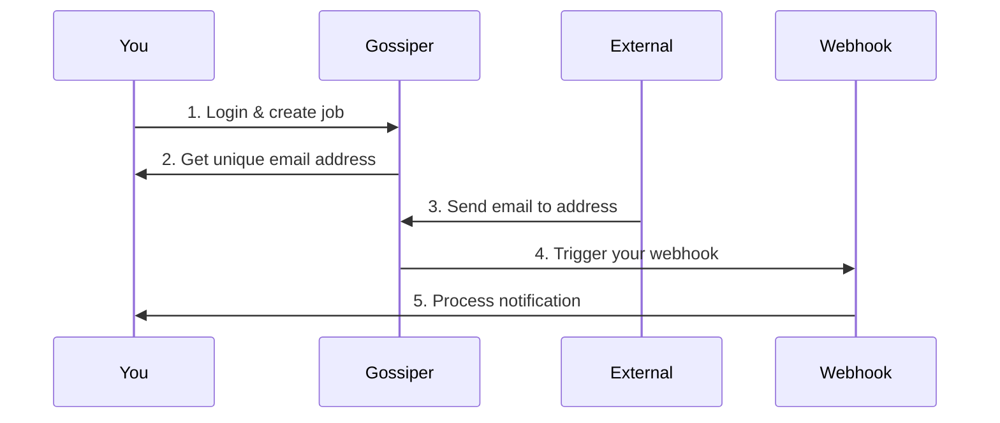

# Gossiper

[](https://woodpecker.v3m.net/repos/1)




Feel free to self host it ~or simply use the deployed version: [here](https://app.v3m.pw)~ (registration is disabled due to heavy bot activity and low volume of actual users)

I stopped pushing updates to this Github mirror. All the work will keep happening in my Forgejo instance.


## Project Structure 

There are three components

1. The web component was adapted and heavily changed from [Pagoda](https://github.com/mikestefanello/pagoda). What they did was great, but I needed something slightly different.
Among the big changes I made, I dropped `Ent` in favor of `Gorm`, I separated the sqlite
task queue from the postgres business DB, and many other things, yet I kept the structure
of the project because it made sense to me. With that being said, there are things I ported from there but I didn't clean yet
(like the contact page).
1. A self explanatory SMPT agent
2. A processing worker


## Development

```bash
docker compose -f docker-compose-test.yml up
```

```bash
go test ./...
```

```bash
air
```

## Deployment

There is a `.drone` deployment pipeline being used today, so feel free to clone / fork and adjust
to your infrastructure.


## Video Demo

[Video](https://odysee.com/@jostiniane:a/gossip_dispatch:3?r=ApaoeHUrRuxq8iobUykDYxZFFXnoJgoM)


## Examples / Templates

### Telegram Hook

POST `https://api.telegram.org/<bot id>:<token>/sendMessage`

```json
{"chat_id": "<chat id>", "text": " {{ .Subject }} -> {{ .Body }}", "disable_notification": false}
```

```json
{
  "Content-Type": "application/json"
}
```

### Github Issue

POST `https://api.github.com/repos/idrissbellil/gossiper/issues?state=all`

```json
{
  "title": "{{ .Subject }}",
  "body": " {{ .Body }}",
  "assignees": ["idrissbellil"],
  "labels": [
    "bug"
  ]
}
```

```json
{
  "Authorization": "token <github fine grained token>",
  "Content-Type": "text/plain; charset=utf-8",
  "Cookie": "logged_in=no"
}
```

